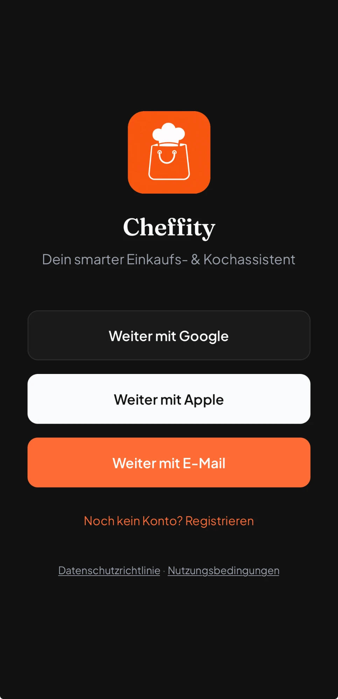
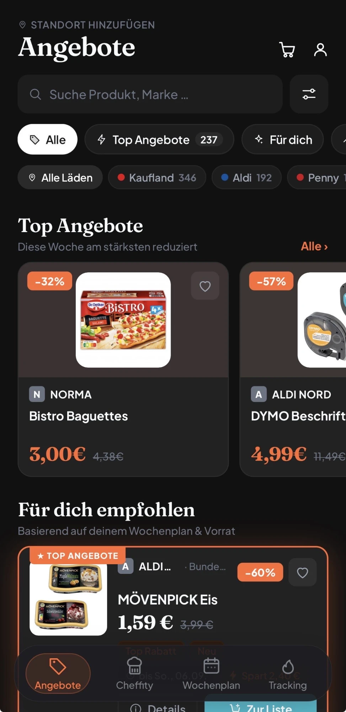

# Cheffity (AICheff)

**Kochen nach Angebot.** Cheffity verbindet die Wochenangebote deutscher
Supermärkte mit Rezepten, Vorrat, Wochenplan und Einkaufsliste. Die App zeigt,
was man diese Woche günstig und passend zu den eigenen Vorlieben kochen kann.

> *English summary: a full-stack meal-planning app (React Native, React,
> Node/TypeScript, Python, Supabase) that turns weekly German supermarket deals
> into recipe suggestions, a pantry, a weekly planner and a shopping list.
> Offer data is collected by store connectors and then cleaned and classified
> with a local LLM (Ollama).*

<p align="center">
  
  &nbsp;&nbsp;
  
</p>

## Was die App kann

| Bereich | Inhalt |
|---|---|
| **Angebote** | Wochenangebote von 11 Ketten (REWE, EDEKA, Lidl, ALDI Nord/Süd, Kaufland, PENNY, Netto, NORMA, HIT, nahkauf), Favoriten, Filter |
| **Rezepte** | Vorschläge aus aktuellen Angeboten und aus dem Vorrat, Rezeptdetails, Kommentare |
| **Vorrat und Einkauf** | Einkaufsliste, Barcode-Scan (Open Food Facts), Abgleich „was fehlt noch?“ |
| **Planung** | Wochenplaner, Ernährungs-Tracking, Trends |
| **Profil** | Onboarding (Allergien, Halal, Alkohol, Portionsgröße, Umkreis), Abo-Stufen über Stripe (Testmodus) |
| **Admin** | Dashboard für Scan-Läufe, Datenqualität, Review-Queues und Store-Gesundheit |

## Architektur

```
 mobile/ (Expo, React Native) ─┐
 src/    (React, Vite Web-MVP) ─┼──► backend/ (Node, Express, TypeScript) ──► Supabase (Postgres, Auth, Storage, Edge Functions)
 admin/  (React Admin-Panel)  ─┘            │
                                            ├──► Store-Connectors (öffentliche Angebotsseiten)
                                            └──► Python-Pipeline (offers_categorizer/, aichef_offers/) ──► Ollama (lokales LLM)
```

Das Datenmodell steht in [docs/aicheff-er-model.png](docs/aicheff-er-model.png).
Die Supabase-Migrationen liegen in [supabase/migrations/](supabase/migrations/),
inklusive Row-Level-Security.

**Stack:** TypeScript, React 19, React Native (Expo 54), Vite, Express 5,
Python 3.12, Supabase (Postgres, RLS, Edge Functions auf Deno), Stripe,
Ollama, Vitest, Pytest.

## Technisch interessante Teile

- **Angebots-Pipeline mit ehrlicher Datenqualität.** Jede Quelle meldet ihre
  Abdeckung (`full`, `partial`, `source-gap`) und schreibt Diagnosen, statt
  Lücken mit geratenen Werten zu füllen. Siehe
  [`src/services/offersIngest/`](src/services/offersIngest/) und
  [`backend/src/storeImportHealth.ts`](backend/src/storeImportHealth.ts).
- **Lebensmittel vs. Non-Food.** Die Entscheidung läuft zentral in
  [`backend/src/foodDecision.ts`](backend/src/foodDecision.ts). Sie kombiniert
  Regeln, Taxonomie und LLM-Klassifizierung und hat einen Review-Pfad für
  unsichere Fälle.
- **Robustheit im Scan.** Timeouts pro Store, Abbruch, Rate-Limiting,
  Fortschritt pro Store und ein Cache für LLM-Antworten.
- **Rezept-Angebot-Matching** mit Konfidenzbändern und einer Regel gegen
  abgeleitete Produkte (zum Beispiel soll „Tomatenmark“ nicht als „Tomate“
  gelten).
- **Sicherheit.** RLS-Policies, eingeschränkte `EXECUTE`-Rechte, Stripe-Webhook
  mit Signaturprüfung und Idempotenz. Das Backend bindet standardmäßig nur an
  `127.0.0.1`.
- **Tests.** Über 130 Vitest-Dateien (Backend, Web, Mobile-Services) und
  Pytest-Suites für die Python-Pipeline.

## Schnellstart

Voraussetzungen: Node 22, npm, optional Python 3.12.

```bash
npm ci
cp .env.example .env
npm run dev               # Web: http://localhost:5173, Backend: http://localhost:8787
```

Nach dem ersten Start gibt es noch keine Angebote. Sie entstehen erst durch
einen Scan, den man im Admin-Dashboard (`/admin-v2`) startet. Ein Scan ruft
öffentliche Angebotsseiten ab. Ein automatischer Wochen-Scan ist
standardmäßig aus (`WEEKLY_SCAN_ENABLED=false`). Supabase, Stripe und Ollama
sind optional. Ohne sie fehlen nur die Funktionen, die sie brauchen.

Mobile-App:

```bash
cd mobile && npm ci && npx expo start
```

Tests:

```bash
npm test                              # Vitest
npx tsc -b                            # Typecheck Web
pip install -r requirements-dev.txt
python -m pytest -q tests             # Python-Pipeline
```

Mehr Details (Umgebungsvariablen, API-Endpunkte, Python-CLI) stehen in
[docs/DEVELOPMENT.md](docs/DEVELOPMENT.md).

## Projektstruktur

| Ordner | Inhalt |
|---|---|
| `mobile/` | Expo-App (Hauptprodukt) |
| `src/` | Web-MVP und gemeinsame Angebots-Ingest-Logik |
| `backend/` | Express-Server: Scan-Orchestrierung, Datenqualität, Admin-API |
| `admin/` | Admin-Panel (React, Supabase Auth) |
| `offers_categorizer/`, `aichef_offers/`, `offers_tool/` | Python-Pipeline: Kategorisierung, Produktanalyse, CLI |
| `supabase/` | Migrationen und Edge Functions (Stripe, Konto löschen) |
| `data/` | Selbst geschriebene Rezept-Seeds und generische Nährwert-Referenzwerte |
| `tests/` | Pytest-Suites und synthetische Fixtures |
| `docs/` | ER-Modell, Stripe- und Pantry-Scanner-Konzepte, Admin-Release-Checkliste |

## Daten und rechtlicher Hinweis

- Das ist ein **privates Lern- und Portfolio-Projekt**. Es wird nicht
  kommerziell betrieben.
- Die Store-Connectors lesen nur **öffentlich zugängliche Angebotsseiten**.
  Sie umgehen keine Logins, Captchas oder anderen Schutzmaßnahmen und halten
  ein Rate-Limit ein. Scans starten nur manuell oder per Zeitplan, also nur
  ein paar Mal pro Woche.
- **Im Repository sind keine gescrapten Daten**: keine Prospektbilder, keine
  Produktfotos, keine Angebots-Dumps. Die Tests nutzen kleine, nachgebaute
  Beispieldaten. Die Screenshots zeigen die App im Betrieb. Die darin
  sichtbaren Produktbilder gehören den jeweiligen Händlern und Herstellern.
- Marken- und Ladennamen dienen nur zur Beschreibung. Alle Rechte daran
  liegen bei den jeweiligen Inhabern.
- Die Rezepte in `data/recipes/` sind selbst geschrieben oder als
  KI-generierte Entwürfe gekennzeichnet.

## Entwicklung mit KI-Unterstützung

Teile des Codes sind mit KI-Assistenten (Claude Code, Codex) entstanden.
Architektur, Anforderungen, Review und Tests habe ich verantwortet.

## Lizenz

Alle Rechte vorbehalten. Der Code ist zur Ansicht veröffentlicht, zum Beispiel
für Bewerbungen. Für eine andere Nutzung bitte vorher fragen.
